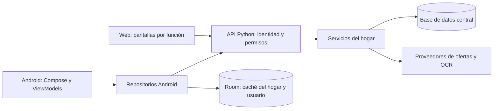

> Estado actualizado: el acceso predeterminado es por usuario y contraseña; el modo de correo es opcional. La arquitectura multi-hogar descrita como objetivo sigue pendiente. Consultar README y PLAN_PROYECTO para el estado vigente.

# Expensa House: arquitectura y evolución hacia hogares compartidos

## Objetivo y criterio

Un mismo hogar podrá usar Android y web. La administradora invitará personas y asignará permisos de edición o lectura. Para lograrlo, las reglas de acceso deben vivir en el servidor y aplicarse a cada recurso, no solamente a los botones de las pantallas.

Se adopta un **monolito modular**: un backend Python, una base de datos central y dos clientes. No se necesitan microservicios para la escala actual. Se conservan Kotlin/Compose y FastAPI, y se organiza la web existente sin introducir otro framework durante esta etapa.

## Estructura vigente después de esta etapa

```text
backend/app/
  main.py                    Construcción de la API y montaje de la web
  api/
    schemas.py               Contratos HTTP de entrada
    routes/                  Stock, compras, presupuesto, ofertas, chat, voz, tickets y sync
  services/                  Búsqueda, OCR, registro de tickets y sincronización
  infrastructure/
    json_store.py            Persistencia local actual y exportaciones heredadas
  core/
    paths.py                 Ubicaciones del proyecto
frontend/web/
  index.html
  css/style.css
  js/
    app.js                   Inicio, navegación y pantallas que faltan extraer
    core/dom.js              Utilidades comunes de presentación
    features/                Ofertas, chat y tickets
app/src/main/java/com/expensahouse/app/
  MainActivity.kt            Contenedor y pantallas heredadas pendientes de extracción
  core/di/AppContainer.kt    Construcción de dependencias
  ui/components/            Imagen de producto, dictado y errores
  ui/features/              Ofertas, chatbot y escáner
  ui/viewmodel/             Estado y eventos del inventario existente
  data/repository/          Contratos de acceso a ofertas, chat y tickets
  data/remote/              Retrofit y modelos de transporte separados
  data/local/               Room
  domain/model/             Modelos existentes
tests/                      Pruebas de comportamiento y compatibilidad
docs/                       Decisiones y siguientes entregas
```

Las antiguas importaciones `web.api`, `web.receipts`, `web.offer_service`, `web.sync_service` y `data.db` se mantienen como adaptadores. Las rutas `/api/...`, `/offers`, `/stock` y `/static/...` siguen disponibles. La ubicación de `data/app_state.json` no cambió y esta etapa no migra ni transforma los datos del hogar.

Las rutas HTTP traducen solicitudes y errores; los servicios de registro de tickets y sincronización ejecutan las operaciones. Los componentes nuevos de Android reciben interfaces de repositorio, lo que permite sustituir el acceso a red para pruebas. La implementación concreta se construye en `AppContainer`.

Esta es una reorganización incremental, no una arquitectura terminada: inventario, compras y presupuesto aún llaman a la persistencia desde sus rutas; los modelos Room todavía se usan en sincronización; parte del estado y las operaciones del escáner siguen en Compose; `MainActivity`, `ExpensaViewModel` y `app.js` aún necesitan divisiones adicionales. Estas limitaciones se documentan para no confundir carpetas nuevas con separación completa de responsabilidades.

## Flujo objetivo



La identidad, las sesiones, los permisos del hogar actual y las invitaciones ya tienen implementación en SQLite; su activación requiere completar SMTP y HTTPS. La migración relacional de inventario y la separación entre varios hogares siguen pendientes. Ver [SEGURIDAD.md](SEGURIDAD.md).

## Sección futura: Mi hogar

La unidad de colaboración será el **hogar**. Una persona podrá pertenecer a más de uno y tendrá un perfil distinto en cada hogar. La administradora asignará acceso mediante el **correo del usuario** y elegirá una de estas tres opciones, confirmadas por la dueña del proyecto:

| Opción | Perfil | Alcance |
|---|---|---|
| **1** | Lectura y escritura completas (`full_editor`) | Consultar y operar todos los módulos funcionales del hogar, incluyendo cargar stock, registrar consumo, editar compras y cargar tickets/gastos. |
| **2** | Lectura completa (`full_viewer`) | Consultar todos los módulos funcionales, incluyendo presupuesto, gastos y detalle de tickets, sin modificar datos. |
| **3** | Lectura de stock y compras (`inventory_viewer`) | Consultar únicamente el stock de la despensa y la lista de compras. Sin cambios ni acceso a los otros módulos. |

La **administradora** es un rol separado de esos perfiles. Solo ella puede otorgar o revocar acceso y cambiar permisos; un usuario de opción 1 no administra integrantes.

| Operación dentro del hogar | Administradora | Opción 1 | Opción 2 | Opción 3 |
|---|---|---|---|---|
| Ver stock y lista de compras | Sí | Sí | Sí | Sí |
| Ver presupuesto, gastos y tickets | Sí | Sí | Sí | No |
| Consultar ofertas, chatbot y dashboard completo | Sí | Sí | Sí | No |
| Agregar, editar y quitar stock | Sí | Sí | No | No |
| Registrar apertura y consumo de unidades | Sí | Sí | No | No |
| Modificar lista de compras | Sí | Sí | No | No |
| Cargar y corregir tickets/gastos | Sí | Sí | No | No |
| Definir presupuesto y editar otros datos funcionales | Sí | Sí | No | No |
| Invitar por correo, cambiar perfil y revocar acceso | Sí | No | No | No |
| Consultar y administrar integrantes | Sí | No | No | No |

Los datos de todos los módulos son compartidos **dentro del hogar** según el perfil asignado; no se comparten datos personales ni datos de otros hogares.

### Recorrido de la administradora

1. Entrar a **Mi hogar → Integrantes → Dar acceso**.
2. Ingresar el correo de la persona y elegir **opción 1, 2 o 3**, con una descripción visible de lo que podrá consultar o modificar.
3. Confirmar la invitación. Si la persona todavía no tiene cuenta, deberá registrarse y verificar ese correo antes de aceptar; si ya tiene cuenta, deberá autenticarse con ese correo verificado.
4. Mostrar la invitación como pendiente hasta su aceptación. Escribir un correo no concede acceso por sí solo.
5. Desde Integrantes, cambiar el perfil o revocar la membresía. Aplicar los cambios a futuras consultas y sincronizaciones.

El servidor resolverá la identidad mediante el correo verificado y guardará la membresía con el ID interno del usuario. Los perfiles no se deducen de nombres visibles ni de un correo enviado sin autenticación.

No se habilitarán enlaces públicos de edición. La pantalla de cada usuario mostrará su hogar activo y el alcance de su acceso. La opción 3 mostrará solamente Stock y Lista de compras.

### Modelo de datos propuesto

- `users`: identidad propia de la persona. No se crea una cuenta real ni se elige un proveedor de identidad en esta etapa.
- `households`: hogar, nombre e identificador.
- `memberships`: usuario, hogar, rol/perfil (`admin`, `full_editor`, `full_viewer` o `inventory_viewer`) y estado; una membresía por usuario y hogar.
- `invitations`: hogar, correo destinatario, perfil elegido (1, 2 o 3), vencimiento, estado y huella del token de un solo uso.
- `stock_items`, `shopping_items`: asociados obligatoriamente a `household_id`, con versión y fechas.
- `inventory_movements`: apertura, consumo y ajustes con usuario responsable.
- `audit_events`: cambios de acceso y operaciones relevantes, con fecha y autor.

Presupuesto, gastos, productos del ticket e imágenes de tickets pertenecen al hogar y estarán disponibles para administradora y opciones 1 y 2. Deben quedar excluidos de las respuestas para opción 3, incluyendo saldos, totales agregados, enlaces de imagen y metadatos financieros.

### Reglas que deberá verificar el servidor

1. Autenticar a la persona y resolver su membresía activa en el hogar solicitado.
2. Obtener el rol desde la base, no desde un rol enviado por Android o por el navegador.
3. Filtrar todos los recursos por el hogar autorizado, incluso búsquedas por ID, chat, exportaciones y sincronización.
4. Rechazar operaciones de escritura a usuarios de lectura aunque envíen peticiones HTTP manualmente.
5. Verificar de nuevo el acceso al sincronizar cambios offline: una revocación debe impedir futuras escrituras.
6. Impedir que una administradora elimine la última membresía administradora del hogar.
7. Evitar invitaciones reutilizables, vencidas o aceptadas por un destinatario distinto; exigir coincidencia con el correo verificado de la cuenta autenticada.
8. La opción 1 no autoriza gestionar integrantes ni elevar permisos; las opciones 2 y 3 nunca autorizan escritura.
9. Para opción 3, limitar tanto endpoints como respuestas a Stock y Lista de compras. No enviar presupuesto, gastos, ofertas, tickets ni datos del dashboard completo en la sincronización global. El chatbot y las exportaciones tampoco deben revelar módulos restringidos.
10. Las consultas de opciones 2 y 3 no deben crear ni modificar datos por efectos secundarios, incluyendo reposición automática, lectura OCR con guardado o operaciones encubiertas en rutas GET.

Los roles anteriores ya se comprueban en los endpoints del hogar actual mediante la dependencia central de autorización. Las rutas heredadas también exigen sesión. La activación del envío de correos y HTTPS y el modelo de múltiples hogares siguen pendientes; ver [SEGURIDAD.md](SEGURIDAD.md).

## Orden de las siguientes entregas

### 1. Completar la separación por responsabilidades

Extraer inventario, lista de compras y presupuesto a pantallas y ViewModels propios; unificar manejo de errores y estados; llevar operaciones de red fuera de Compose; separar persistencia y dominio de los modelos HTTP/Room. Hacer lo mismo con las partes restantes de `app.js`. Conservar los contratos públicos hasta que se coordine una versión nueva de ambos clientes.

### 2. Datos e identidad

Introducir almacenamiento relacional con migraciones versionadas, usuarios, hogares y membresías. PostgreSQL es el destino propuesto para el entorno compartido; decidir el entorno local y el mecanismo de autenticación al implementar esta entrega. Preparar una importación explícita del JSON existente, con copia de respaldo y verificación de cantidades e importes. La primera administradora se vinculará mediante un proceso de configuración autorizado, no por ser la primera persona en registrarse.

### 3. Autorización e invitaciones

Implementar una política central de permisos y aplicarla a todos los endpoints. Probar aislamiento entre hogares, escritura denegada a opciones 2 y 3, ausencia de datos financieros para opción 3, gestión de permisos denegada a opción 1, revocación de acceso, correo verificado de invitaciones, invitaciones vencidas y protección de la última administradora. Deshabilitar o proteger las rutas heredadas para que no permitan eludir esas políticas.

### 4. Mi hogar en Android y web

Agregar acceso a cuenta, selector de hogar, integrantes, invitaciones por correo con selector de opción 1/2/3, edición de perfil y revocación. Los botones se adaptarán a los permisos que devuelve el backend. Los mensajes deben explicar por qué una acción está deshabilitada sin exponer detalles internos.

### 5. Sincronización por hogar y publicación

Reemplazar el envío global de instantáneas por operaciones con versión, autor e identificador de reintento. Room y los envíos pendientes deben separar usuario y hogar; al cerrar sesión o perder acceso no se debe mezclar información de cuentas diferentes. Antes de publicar: HTTPS, sesiones, configuración de orígenes y secretos, respaldos y pruebas de recuperación.

## Comprobación de esta etapa

```powershell
.\.venv\Scripts\python.exe -m uvicorn backend.app.main:app --host 0.0.0.0 --port 8000
.\.venv\Scripts\python.exe -m unittest discover -s tests -v
Get-ChildItem frontend/web/js -Recurse -Filter *.js | ForEach-Object { node --check $_.FullName }
.\gradlew.bat :app:assembleDebug --offline --console=plain
```

No se cambió de framework. La reorganización tiene pruebas de compatibilidad y la implementación posterior de autenticación tiene pruebas separadas de permisos, sesiones, verificación de correo e invitaciones. Las etapas anteriores describen el orden de evolución; consultar el estado actual y la configuración pendiente en [SEGURIDAD.md](SEGURIDAD.md).

Referencias de organización: [aplicaciones modulares con FastAPI](https://fastapi.tiangolo.com/tutorial/bigger-applications/) y [guía de arquitectura de Android](https://developer.android.com/topic/architecture). La división y el orden de entrega son decisiones para este proyecto.
