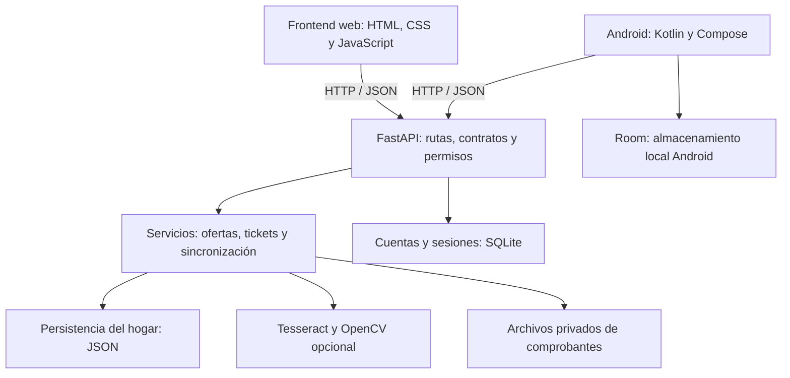

# Expensa House · guía de revisión y ejecución para el docente

## Qué resuelve

Una aplicación doméstica para organizar existencias, preparar compras, comparar ofertas y controlar gastos. Tiene una web y un cliente Android. Ambos usan una API Python compartida. El presupuesto y los tickets son un módulo contable del hogar; no se conectan con bancos ni tarjetas.

## Por dónde empezar

1. Leer esta guía: problema, instalación, demostración y límites.
2. Abrir [GUIA_CODIGO.md](GUIA_CODIGO.md): responsabilidades y archivos, con explicaciones para principiantes.
3. Revisar [ARQUITECTURA.md](ARQUITECTURA.md): decisiones, separación incremental y evolución propuesta.
4. Leer [GASTOS_Y_COMPROBANTES.md](GASTOS_Y_COMPROBANTES.md): OCR, archivo de lectura y cálculos mensuales.
5. Ejecutar [REGRESION.md](REGRESION.md) y consultar [resultados locales](QA_RESULTADOS_2026-10-28.md).
6. Consultar [PLAN_PROYECTO.md](../PLAN_PROYECTO.md) para conocer las tareas pendientes.

## Arquitectura en una frase

Se utiliza un **monolito modular**: un backend organizado por responsabilidades y dos clientes independientes. La web y la API pueden ejecutarse con un único proceso local; separar carpetas no obliga a contratar dos servidores.



Parte de inventario, compras y presupuesto aún accede a persistencia desde las rutas. `app.js` y `MainActivity` conservan operaciones pendientes de extraer. El objetivo es una separación progresiva comprobable, no presentar una arquitectura terminada solo por sus nombres de carpetas.

## Requisitos recomendados

- Git y Python 3.12 para API/web y pruebas.
- Node.js 22 para pruebas de navegador; no es necesario para abrir la aplicación web normal.
- Tesseract instalado en el sistema para leer imágenes. Sin él se puede interpretar texto pegado.
- Android Studio, JDK 17 y SDK Android 35 si se revisa el cliente móvil.
- La API local no requiere una cuenta de Vercel ni acceso a los datos del hogar de la autora.

## Ejecución web y backend desde una copia nueva

En PowerShell:

```powershell
git clone https://github.com/griseldablanco78-blip/Expensas_House.git
Set-Location Expensas_House
python -m venv .venv
.venv/Scripts/python.exe -m pip install -r requirements.txt
Copy-Item .env.example .env
.venv/Scripts/python.exe scripts/crear_administradora.py
.venv/Scripts/python.exe -m uvicorn backend.app.main:app --host 127.0.0.1 --port 8000
```

El configurador solicita un usuario y una contraseña de al menos 15 caracteres, escrita de forma oculta. La cuenta es del entorno del docente: no hay credenciales predeterminadas ni se necesita usar las de la autora.

Abrir [aplicación local](http://127.0.0.1:8000) e ingresar con la cuenta creada. Abrir [contratos de API](http://127.0.0.1:8000/docs) para inspeccionar entradas y salidas. Los endpoints privados requieren autenticación; que aparezcan en Swagger no los vuelve públicos.

Al crear el almacenamiento, el código actual incluye datos domésticos de ejemplo. Sirven para demostración y no certifican precios ni promociones vigentes. El proveedor de ofertas externo es opcional y está sin configurar en `.env.example`.

### Escaneo de imágenes

Instalar Tesseract desde su distribución para el sistema operativo e indicar su ejecutable en `TESSERACT_CMD` cuando no esté disponible en PATH. Indicar únicamente idiomas instalados en `TESSERACT_LANG`.

Para el modo de fotos con sombras:

```powershell
.venv/Scripts/python.exe -m pip install -r requirements-ocr.txt
```

El flujo normal funciona con Pillow y Tesseract; OpenCV es opcional. Para una prueba reproducible puede usarse `tests/fixtures/ticket-sintetico.png`, sin datos personales.

### Android

Abrir la raíz del repositorio en Android Studio y sincronizar Gradle. Crear `local.properties` con la ubicación del SDK del equipo y `expensa.apiBaseUrl` apuntando a la API de prueba. Para una revisión local sin publicar la API, conectar un emulador o un teléfono por USB y ejecutar `adb reverse tcp:8000 tcp:8000`; configurar `expensa.apiBaseUrl=http://127.0.0.1:8000/` en `local.properties`, compilar e instalar la variante debug. El reenvío ADB lleva ese puerto del dispositivo a la API loopback de la PC. HTTP está permitido únicamente en este recorrido local de depuración. Para acceso por Internet o Wi-Fi usar una API HTTPS accesible.

Un teléfono no puede acceder al servidor de la PC usando `127.0.0.1`, porque esa dirección se refiere al propio teléfono. Los enlaces temporales de túnel cambian y pueden vencer; no están versionados como dirección de producción. Nunca desactivar la validación TLS para resolver un problema de conexión.

Compilar:

```powershell
.\gradlew.bat :app:assembleDebug --console=plain
```

## Demostración sugerida (5–7 minutos)

1. Mostrar inventario y lista de compras.
2. Crear una oferta de prueba y buscarla; señalar que el origen es manual.
3. Abrir **Presupuesto y gastos**, pegar texto o subir el ticket sintético.
4. Revisar fecha, supermercado, productos y total antes de confirmar.
5. Elegir el mes de compra, mostrar gasto, saldo, archivo de texto e imagen cuando exista.
6. Consultar Boti House por presupuesto/faltantes; explicar que usa reglas y datos del hogar.
7. Mostrar las pruebas automáticas y un reporte. Distinguir simulaciones de las integraciones reales.

## Qué no está terminado

No hay URL de producción verificada. La persistencia sigue siendo local (JSON/SQLite/archivos); una publicación permanente necesita almacenamiento persistente o migración. La web tiene selector mensual; Android conserva el historial anterior. El presupuesto es una referencia común, no un presupuesto diferente almacenado por mes. No hay aislamiento implementado para múltiples hogares independientes. El OCR no garantiza precisión con fotografías reales y sus resultados se revisan antes de registrar gastos. La selección de cámara/galería física sigue formando parte de la regresión manual.

## Archivos que no se entregan

`.env`, `local.properties`, bases de cuentas, datos del hogar, imágenes de tickets personales, certificados y llaves de firma están excluidos de Git. Los ejemplos necesarios para configurar el proyecto se entregan con nombres ficticios y valores vacíos.
